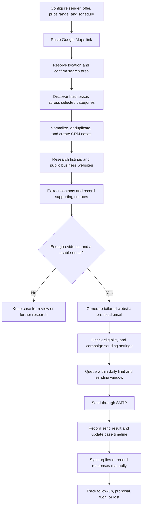

# Sales Agent — Project Requirements and Implementation Plan

Last updated: 3 October 2026
Status: First working local version implemented; production campaign inputs are still pending.

## Implementation update — 3 October 2026

The first working application is **Scout**, in this project folder. See [README.md](README.md) for startup, operation, and current limitations.

Implemented:

- React/Vite interface with overview, discovery, prospects, CRM board/list, case details, outreach, inbox, and settings.
- Node/Express server with durable SQLite records and jobs, authenticated workspace access, and encrypted credentials.
- Two supplied Gmail sender accounts configured locally. SMTP and IMAP authentication verified without sending mail or fetching inbox messages.
- Google Maps coordinate/short-link resolution, category searches, deduplication, OpenStreetMap discovery, and an optional Google Places adapter.
- Public website research, automatic website lookup for incomplete listings, branch-matched contact extraction, source evidence, research gaps, observed business activities, and editable evidence-based email templates. Recipient details autofill where verified; manual edits are optional. Public search is best-effort and may be rate-limited.
- Automatic eligible initial outreach after campaign activation; daily capacity, spacing, suppression, duplicate protection, and delivery-uncertainty handling.
- IMAP matching for prospect replies, manual replies from the CRM, notes, next actions, and pipeline stages.
- Backend regression tests, isolated desktop/mobile browser checks, Docker packaging, and local setup instructions.

Current implementation decisions superseding earlier provisional suggestions below:

1. **Self-hosted Node app**, because SMTP and IMAP need TCP connections that the available Sites hosting runtime does not support. Nothing has been publicly deployed.
2. **SQLite for the single-operator MVP**, replacing the provisional PostgreSQL choice. Jobs run durably in one application process; horizontal worker scaling is not supported yet.
3. **Shared daily cap of 5–10 messages across both senders and all campaigns**, including manual replies. The default is 5 total per day, not 5 per account.
4. **Evidence-based templates, without an LLM API**. Richer model-based synthesis is a future enhancement; no model credential is required for the current version.
5. **Bounded discovery**: OpenStreetMap returns at most 300 results per search; Google Places returns at most 20 per category. Searches now run per category with bounding-box queries, radius filtering, incremental saves, one retry, and visible partial-result diagnostics. Comprehensive geographic subdivision is not implemented.
6. **Manual retry of definite sending failures**; uncertain sends are held, never automatically retried.
7. **Inbox sync is bounded** to the latest 100 messages from 30 days and imports only matched prospect conversations. Asynchronous bounce classification, full historical sync, CSV export, data-deletion controls, and automated follow-ups remain future work.
8. **No live outreach has started**. The user still needs to configure a target location, website price range, service scope, and activate a campaign. The app starts with real empty prospect data, not demo leads.

The remaining sections preserve the original product requirements and longer-term plan. Unchecked acceptance items below are planning targets; the README describes what is available now.

## 1. Purpose

Build a web application that finds local businesses, researches them, collects publicly available business contact details, and sends personalized emails offering website design and development services. The same application should provide CRM-style tracking so the user can manage prospects, outreach, replies, and deals in one place.

This document is the project's working source of context. Update it as the user explains further requirements. Keep confirmed requirements separate from suggested implementation choices. Creating this plan does not initiate prospect collection or send any emails.

## 2. Confirmed user requirements

| ID | Requirement |
| --- | --- |
| R1 | Build a sales agent for selling personalized website services. |
| R2 | Send approximately 5–10 outreach emails per day. |
| R3 | Research each company or business before contacting it. |
| R4 | Accept a Google Maps location link and discover nearby restaurants, cafes, fast-food outlets, shops, and other local businesses. |
| R5 | Accumulate business data and provide a detailed research profile for each business. |
| R6 | Extract available business email addresses and phone numbers. |
| R7 | Automatically send personalized emails that reflect the business model and offer a website within a user-entered price range. |
| R8 | Create a case or lead record for each prospect and provide CRM tracking and email management inside the web application. |
| R9 | Send email using the user's SMTP credentials. |

“All businesses” means the widest practical discovery within a defined area and selected categories. Available sources may omit businesses, limit results, or lack contact information. The application must show coverage and missing data rather than claim guaranteed completeness.

## 3. Proposed MVP boundaries

The first version should support one operator, one connected sender, configurable campaigns, background discovery and research, personalized outreach, and a usable CRM.

Include:

- Google Maps link input with a confirmed geographic area and business categories.
- Business discovery through an appropriate location-data provider.
- Deduplication and persistent prospect records.
- Research from business listings and accessible public business websites.
- Public business email and phone extraction with source links.
- Evidence-based website opportunity analysis.
- User-defined pricing, currency, service scope, and sender identity.
- Automatic initial outreach after the user enables a campaign.
- A daily send limit configurable from 5 to 10, plus scheduling and pause controls.
- SMTP delivery, delivery-attempt logs, and failure handling.
- CRM pipeline, notes, tasks, email history, and reply tracking.

Defer unless requested:

- Automated phone calls, SMS, or WhatsApp outreach.
- Building or publishing the offered websites automatically.
- Payment collection, contracts, and invoicing.
- Multiple sales teams and complex role management.
- Purchased lead lists, private data collection, and guessed email addresses.
- Large-volume outreach and advanced marketing analytics.

## 4. End-to-end flow

### Step 1: Configure the offer and sender

Collect:

- Sender/business name, reply address, signature, and portfolio link if available.
- SMTP host, port, username, password or app password, and supported TLS mode.
- Service description and concrete deliverables.
- Minimum and maximum website price, currency, and whether pricing is fixed or indicative.
- Optional delivery estimate and exclusions such as hosting, domain, maintenance, or taxes.
- Email language and tone.
- Daily limit, timezone, sending days, and sending hours.

Validate that the minimum price does not exceed the maximum. Use only supplied pricing and service commitments; the agent must not invent discounts, guarantees, portfolio claims, or delivery dates.

### Step 2: Define the search area

The user pastes a Google Maps link. The application resolves supported links and displays the interpreted location on a confirmation screen.

- Support place links, coordinate links, and shortened links where resolvable.
- Ask for clarification inside the application if a link is ambiguous or points to a broad area.
- Let the user choose a radius or supported geographic boundary.
- Let the user include categories such as restaurants, cafes, fast-food outlets, retail shops, salons, and other local businesses.
- Offer filters such as independent businesses, chains, businesses without a known website, and businesses with an existing website.
- Do not silently interpret a single place link as permission to search an unlimited region.

Suggested starting radius: 3 km, editable before discovery. This is a proposal, not a confirmed user requirement.

### Step 3: Discover and collect businesses

Use a supported provider or integration to search the chosen area and categories. A Google Maps URL supplies location context; it is not by itself a complete business dataset.

- Page through available results and subdivide large search areas where the provider supports it.
- Track searches, categories, geographic coverage, provider limits, and failures.
- Save records incrementally so interrupted jobs can resume.
- Normalize business names, addresses, domains, phone numbers, and provider identifiers.
- Deduplicate overlapping category and area results.
- Preserve branches as separate locations when appropriate while recognizing shared ownership, domains, or contact addresses.
- Show discovered count, unique count, duplicates, incomplete records, and unfinished searches.

Provider selection, current access terms, storage permissions, quotas, pricing, and supported search coverage must be verified during implementation. Do not design the product around guaranteed access to Google Maps page scraping.

### Step 4: Research each business

Create a readable profile using accessible public business information:

| Area | Information to capture |
| --- | --- |
| Identity | Name, category, branch, address, location, and listing link. |
| Operations | Products/services, opening hours, ordering/booking options, and service area when available. |
| Online presence | Official website, contact page, and clearly associated public business profiles. |
| Listing signals | Rating and review count when supplied by a permitted source, with observation date. |
| Business model | Short evidence-based description of what the business sells and how customers engage. |
| Website opportunity | Relevant features and observed gaps that a proposed website could address. |
| Contacts | Public business emails and phone numbers, their source, and validation status. |
| Evidence | Source URLs, retrieval times, confidence, and unresolved contradictions. |

Store observed facts separately from inferred recommendations. For example, an online menu is a reasonable recommendation for a cafe, but the agent must not claim the cafe lacks one unless the available evidence supports that statement.

If no website is found, record “No website found in checked sources,” not “This business has no website.” Missing facts remain unknown. A complete profile means the available research is organized and gaps are visible; it does not mean inventing every field.

### Step 5: Extract and validate contacts

- Check official home, contact, about, booking, and footer sections where accessible.
- Extract visible email addresses, mailto links, phone text, tel links, and relevant structured data.
- Prefer published business contact addresses associated with the prospect.
- Normalize phone numbers only when country context is known; retain the original value.
- Remove duplicates and reject malformed addresses, placeholders, and unrelated third-party contacts.
- Record whether a contact came from an official site or another source.
- Distinguish syntax/domain checks from confirmed mailbox deliverability; basic validation cannot guarantee delivery.
- If multiple contacts are available, rank candidates and select one initial recipient per business.
- If no suitable email is found, retain the lead as “No email found” and skip automatic sending.
- Phone collection supports the CRM only; the MVP does not automatically call or message those numbers.

### Step 6: Generate a personalized email

Each email should contain:

1. A short subject relevant to the business.
2. A genuine opening based on a sourced business detail.
3. A concise website idea connected to its products, services, or customer journey.
4. Two or three relevant features rather than a generic feature dump.
5. The configured price range and currency, with the configured scope qualification.
6. A simple invitation to reply.
7. Sender identity and a straightforward opt-out option.

Possible feature suggestions:

| Business | Example website features |
| --- | --- |
| Restaurant or cafe | Menu, gallery, directions, reservation enquiry, or links to existing ordering channels. |
| Fast-food outlet | Mobile menu, opening hours, offers, and pickup enquiry or configured ordering integration. |
| Retail shop | Product showcase, location details, store hours, and customer enquiries. |
| Salon or service business | Service list, portfolio, pricing display, and appointment enquiry. |

Suggest features only within the user's service scope. Do not imply that complex ordering, payment, or booking systems are included if the offer does not include them.

Example template, with placeholders rather than invented prospect facts:

> Subject: Website idea for {{business_name}}
>
> Hi {{business_name}} team,
>
> I noticed {{verified_business_detail}} while looking at {{source_context}}.
>
> I'd love to build a website for {{business_name}} that makes it easier for customers to {{relevant_customer_action}}. It could include {{feature_1}}, {{feature_2}}, and {{feature_3}}.
>
> For {{configured_scope}}, my price range is {{currency}} {{minimum_price}}–{{maximum_price}}, depending on the final requirements.
>
> Would you be interested in discussing a few ideas?
>
> {{sender_signature}}
>
> If you'd prefer no further emails from me, just let me know.

All placeholders must resolve before a message is eligible to send. Preserve the exact email content and evidence snapshot used for each send.

### Step 7: Schedule and send automatically

- The user configures and enables the campaign; eligible emails can then send without individual approvals.
- Offer draft-review mode as an optional setting, not a mandatory step for every email.
- Suggested initial daily cap: 5, adjustable up to 10.
- Treat the cap as a maximum, not a requirement to contact unsuitable prospects.
- Apply the shared cap across all campaigns and sender accounts. Count every outgoing message against it; automated follow-ups remain future work.
- Space sends within the configured local-time sending window.
- Reserve send capacity atomically so concurrent workers cannot exceed the cap.
- Prevent repeated outreach to the same business/contact across overlapping campaigns.
- Recheck suppression, campaign status, contact validity, and message eligibility immediately before sending.
- Allow immediate pausing of future sends. Already submitted mail cannot be recalled by pausing.
- Retry clear transient failures with bounded backoff. Do not blindly retry an ambiguous SMTP result that may already have been accepted.
- Store queued, sending, accepted by SMTP, failed, and delivery-uncertain states separately.
- SMTP acceptance means the server accepted the message; it does not prove inbox delivery or that the recipient read it.

### Step 8: Track the prospect in the CRM

Create a case as soon as a unique business is saved, including leads without contact details.

Suggested sales pipeline:

`New → Qualified → Contacted → Replied → Interested → Proposal sent → Won / Lost`

Keep research and email-processing states separate from sales stage. For example, “Researching,” “No email found,” and “Queued” are operational states, not sales outcomes. Store “Do not contact” as an independent suppression flag that blocks sending at any stage.

Each case should provide:

- Business profile, source links, contact details, and research summary.
- Website opportunity notes and generated email drafts.
- Exact outgoing messages, sending results, and incoming replies when connected.
- An activity timeline, internal notes, and tasks with due dates.
- Editable sales stage, proposed price, and next action.
- Actions to research again, edit a draft, queue a message, send an allowed reply, pause outreach, or suppress the prospect.
- Search and filters by area, business category, stage, email availability, and last activity.

### Step 9: Receive replies and manage follow-ups

SMTP sends email; it does not fetch inbox messages. To manage incoming replies inside the application, add IMAP or a supported mailbox-provider integration.

- Match replies using message identifiers and thread headers where available.
- Use cautious fallback matching and send ambiguous matches to review.
- Stop pending automated follow-ups when a reply or opt-out is detected.
- Store opt-outs in a sender-wide suppression list, including across campaigns and rediscovery.
- Process bounces when the connected mailbox/provider exposes them; suppress confirmed invalid recipients.
- Show inbox sync health so the user knows when replies may be missing.
- Suspend automated follow-ups when reply monitoring is stale or disconnected.
- If inbox access is unavailable, support manually recording replies, but clearly show that automatic inbox tracking is unavailable.

Suggested MVP behavior: automatic initial outreach, manual replies from the CRM, and automated follow-ups disabled until their timing and maximum count are configured. Manual replies should have a separate visible limit policy; they must not be used to bypass outreach limits.

## 5. Application screens

| Screen | Purpose |
| --- | --- |
| Dashboard | Discovery totals, research progress, leads ready to contact, today's send capacity, replies, deals, and job failures. |
| Campaign setup | Maps link, area, categories, offer, pricing, schedule, and enable/pause controls. |
| Discovery results | Search coverage, business list, deduplication results, filters, and research status. |
| Lead detail | Business research, evidence, contacts, email thread, notes, tasks, and deal stage. |
| CRM board/list | Move and filter prospects through the sales pipeline. |
| Outreach queue | Review drafts, inspect scheduled sends, edit messages, and resolve failures. |
| Inbox | Read and reply to matched prospect conversations when inbound integration is connected. |
| Settings | SMTP, inbox connection, sender identity, timezone, daily limit, service defaults, and integration credentials. |

## 6. Proposed technical design

These are provisional architecture choices, not user-mandated technologies.

| Component | Proposed approach |
| --- | --- |
| Web application | TypeScript with Next.js for the interface and server endpoints. |
| Database | PostgreSQL for businesses, campaigns, contacts, CRM records, and communication history. |
| Background work | A durable job queue with a separate worker for discovery, research, generation, sending, and inbox sync. |
| Queue infrastructure | Redis-backed jobs, or a database-backed queue if that simplifies the chosen hosting environment. Choose one during implementation. |
| Business discovery | Provider adapter so location-data sources can be selected or replaced. |
| Website research | Bounded HTTP fetching and HTML parsing; browser rendering only when necessary and supported. |
| Email | SMTP transport with authenticated sender configuration and structured send-attempt logging. |
| Inbound mail | IMAP or mailbox-provider adapter, selected to match the user's email service. |
| AI | Model adapter for research summarization and email drafting, using structured inputs and outputs. |
| Access | Authenticated operator access; secure server-side storage of credentials. |

Long-running jobs must not depend on an open browser tab. Each job should record status, progress, retry count, error reason, and completion time.

Treat fetched websites and external business text as untrusted data: their content must never override agent instructions, expose credentials, or trigger unrelated actions. Restrict URL fetching to public network destinations, including after redirects, with timeouts and response-size limits.

## 7. Core data model

| Entity | Important fields |
| --- | --- |
| Campaign | Location input, resolved area, categories, filters, offer configuration, price range, currency, timezone, schedule, status. |
| Business | Internal ID, provider IDs, name, category, address, coordinates, domain, maps link, deduplication keys. |
| Campaign prospect / CRM case | Campaign ID, business ID, sales stage, qualification status, next action, proposed value, last activity. |
| Contact | Business ID, type, original and normalized value, source URL, validation status, primary flag. |
| Research snapshot | Business ID, observed facts, inferred recommendations, unknowns, sources, timestamps, confidence, version. |
| Email message | Case ID, sender, recipient, subject, text/HTML body, research/offer version, direction, thread identifiers, status. |
| Send attempt | Message ID, idempotency key, capacity reservation, timestamps, SMTP response category, retry or uncertainty status. |
| Activity / note / task | Case ID, event type, content, due date, completion state, timestamp. |
| Suppression | Normalized recipient and/or business ID, reason, timestamp, origin. |
| Sender connection | Sender identity, SMTP settings, encrypted secret references, optional inbox settings, connection health. |
| Discovery run / job | Campaign ID, area/category progress, provider cursor, status, result counts, failure details. |

Keep business identity independent of campaign membership. A business may appear in multiple campaigns, but shared identity and recipient history must prevent accidental repeated outreach.

## 8. Reliability and data handling

- Keep credentials on the server, encrypted at rest, excluded from browser responses and logs.
- Use TLS appropriate to the configured SMTP provider; do not silently downgrade a failed secure connection.
- Support credential updates and connection tests without initiating a campaign.
- Record source URLs and retrieval times so research can be checked and refreshed.
- Restrict collection to relevant public business information and respect source access restrictions.
- Allow prospect data export and deletion; preserve the minimum suppression information needed to prevent renewed outreach according to the configured retention policy.
- Configure outreach requirements for the actual sender and target regions before live launch; do not assume one universal set of rules.
- Sanitize rendered website content and emails.
- Keep an audit trail of campaign activation, message edits, sends, stage changes, and suppression changes.
- Use a test mailbox or mail sandbox during development. Live sending requires a configured, enabled campaign.

## 9. Important failure cases

| Situation | Expected behavior |
| --- | --- |
| Invalid or unsupported Maps link | Explain the problem and allow a location/address fallback. |
| Search reaches a provider limit | Save progress and show partial coverage; resume when possible. |
| Duplicate business or shared recipient | Merge/link records appropriately and block duplicate outreach. |
| Website is missing, blocked, or unavailable | Keep available listing data and mark research gaps. |
| Conflicting business details | Preserve sources and avoid using disputed facts in automatic personalization. |
| No email or insufficient research | Keep the case and skip automatic sending. |
| Missing pricing or unresolved template text | Block queue eligibility until corrected. |
| SMTP authentication failure | Pause sender processing and show a configuration error. |
| Transient SMTP rejection | Retry within defined limits without consuming multiple send slots for the same accepted message. |
| Connection drops after possible acceptance | Mark delivery uncertain and avoid automatic duplicate sending. |
| Daily cap reached | Keep remaining messages queued for the next allowed window. |
| Reply, opt-out, or confirmed hard bounce | Cancel eligible pending outreach and update the case or suppression record. |
| Inbox synchronization fails | Show degraded inbox status and pause automatic follow-ups. |
| Campaign paused or worker restarted | Preserve progress and prevent paused or duplicate sends. |

## 10. Implementation phases

### Phase 1: Foundation and CRM

Create the authenticated application, database, campaign settings, business records, case list/detail pages, notes, tasks, and stage management.

Completion condition: a manually added business can be tracked through the pipeline with persistent history.

### Phase 2: Location discovery

Implement link resolution, area confirmation, provider integration, category searches, pagination, coverage reporting, and deduplication.

Completion condition: a test location produces saved, deduplicated business cases with source links and visible search coverage.

### Phase 3: Research and contact extraction

Implement website fetching, business-detail extraction, contact normalization, evidence storage, and research summaries.

Completion condition: each researched lead shows supported facts, unknowns, relevant website ideas, and available contact sources.

### Phase 4: Personalized email generation

Implement offer configuration, structured generation, draft editing, and eligibility checks.

Completion condition: eligible leads receive distinct drafts grounded in research and the configured price range, without invented claims or unresolved placeholders.

### Phase 5: SMTP and automation

Implement connection setup, test delivery, durable sending jobs, daily capacity accounting, deduplication, pause controls, and failure handling.

Completion condition: a test campaign sends only eligible messages, respects its daily cap, and survives retries/restarts without duplicate sends.

### Phase 6: Inbox and CRM communications

Implement the selected inbound connection, reply matching, conversation display, CRM replies, suppression handling, and next-action tasks.

Completion condition: a test reply appears on the correct case, can be answered in the application, and cancels pending automated follow-ups where applicable.

### Phase 7: Launch readiness

Validate the complete flow using test businesses and controlled recipient addresses. Configure deployment, database backups, job monitoring, source credentials, and the sender's production settings.

Completion condition: discovery through CRM reply tracking works end to end, failure states are visible, and the operator can enable and pause a live campaign.

## 11. Acceptance criteria

- [ ] The user can enter a Google Maps link and confirm the intended area and categories.
- [ ] Discovery creates persistent business records and CRM cases without repeated entries from overlapping searches.
- [ ] Search progress and coverage limitations are visible.
- [ ] Research summaries include sources and distinguish facts from suggestions.
- [ ] Public business emails and phone numbers are stored with provenance; missing contacts remain explicit.
- [ ] The user can set website service scope, currency, and minimum/maximum price.
- [ ] Emails reference supported business details and stay within the configured offer.
- [ ] An enabled campaign can automatically send eligible initial emails through SMTP.
- [ ] The workspace cannot exceed the configured 5–10 daily outgoing-message cap across campaigns and senders. The MVP uses one worker process.
- [ ] Retries, restarts, duplicate discovery, and uncertain SMTP outcomes do not trigger uncontrolled duplicate sends.
- [ ] Opted-out recipients and suppressed businesses are blocked across campaigns.
- [ ] CRM cases show research, exact messages, send results, notes, tasks, and stage changes.
- [ ] With an inbound connection, replies appear in the application and attach to the correct case.
- [ ] The user can send a manual reply from the CRM using the connected sender.
- [ ] Pausing a campaign prevents subsequent queued sends.
- [ ] Credentials remain protected and are absent from client responses and logs.

## 12. Decisions to refine with the user

These questions do not block documenting the project. Resolve each before implementing the part that depends on it.

| Decision | Current proposal or reason it matters |
| --- | --- |
| Target city/country and search radius | Determines discovery boundaries, language, and contact normalization. |
| Website price range and currency | Must be supplied before email generation and sending. |
| Included website services | Determines which features the agent may offer. |
| Sender name, business identity, and portfolio | Supplies truthful email identity and credibility details. |
| SMTP provider and inbox access | Determines sending configuration and how replies can appear in the CRM. |
| Business selection | Confirm whether to target businesses without known websites, businesses needing improvements, or both. |
| Categories and chain handling | Confirm what “anything” includes and whether chains/franchises are useful prospects. |
| Research/discovery budget | Determines provider and model choices, search breadth, and refresh frequency. |
| Sending schedule | Proposed default is 5/day, with timezone and hours set by the user. |
| Automatic follow-ups | Proposed off initially; define delay and maximum count before enabling. |
| Hosting and user count | Proposed single operator; deployment target remains undecided. |
| Outreach language and tone | Sets the default for generation and CRM replies. |

## 13. Instructions for future implementation work

1. Read this document before making architecture or workflow changes.
2. Treat Section 2 as confirmed requirements and other proposals as revisable defaults.
3. Add new user requirements to this document and update affected flow, data-model, and acceptance sections together.
4. Verify provider capabilities, documentation, access terms, and costs when choosing integrations.
5. Keep discovery, research, generation, sending, and reply synchronization as separately observable jobs.
6. Preserve evidence and exact sent-message history; never replace missing facts with fabricated details.
7. Enforce send limits, suppression, and duplicate protection in server-side workers, not only in the interface.
8. Use controlled recipients for development and integration verification.
9. Do not expand into calls, messaging channels, automatic website production, or payment collection without an additional requirement.
10. Update this plan as decisions are confirmed so future implementation work has complete context.

## Hosting implementation update — Vercel and Neon

- Vercel project: `scout-sales-agent`, scope `ajay-raos-projects`.
- Database: Neon PostgreSQL, free plan, Singapore. SQLite remains a local development fallback and backup.
- Imported the existing password hash, two encrypted SMTP sender accounts, 300 businesses/cases, four drafts, activity history, and queued work. Existing campaign state remains draft.
- Replaced synchronous database callers with async queries and transaction-safe PostgreSQL access. Quota reservations, job creation, and worker ownership coordinate through the database.
- Vercel serves the Vite frontend plus an Express API function. Production secrets use Vercel environment variables; local databases and environment files are excluded from uploads.
- Current Hobby scheduling: one daily cron plus authenticated dashboard-triggered work. Fully unattended, spaced outreach still requires a frequent external scheduler or a suitable Vercel plan. This is an outstanding deployment limitation, not a completed automation feature.
- Outstanding product requirement from the contact-filter request: restrict the visible Prospects list to businesses with both email and phone. Current discovery/research still retains incomplete businesses. Direct Google Places discovery requires a configured Places key; Google supplies phone/website, while email must be found on the business website.

## Live verification — 10 October 2026

Verified production password login/logout, access guards, persistent dashboard data, Maps coordinate parsing, temporary campaign/lead creation, CRM stage and notes, website research, draft editing/queueing/cancellation, desktop routes, mobile layout, SMTP authentication for both senders, and IMAP synchronization for both senders. No outbound test email was sent, so actual delivery and reply matching remain unverified end to end.

The first discovery check failed with HTTP 504 from the public Overpass provider. Added a second public Overpass instance for the retry, covered the fallback with a regression test, deployed it, and confirmed the live discovery request then completed. External-provider availability and contact coverage remain best-effort. All 23 local regression tests passed. Temporary live-test campaign records were removed. Detailed results are in ignored `test-results/live-check.json` and `test-results/live-discovery-recheck.json`.

## Authorized delivery and reply test — 10 October 2026

With explicit permission, sent exactly one test email from the first connected Gmail account to the second, then one test reply back. Both were sent through the live Vercel queue and independently found in their receiving Gmail inboxes. The second account's received test email was seeded into its test case to exercise the reply-drafting API; the return reply was imported automatically by the live inbox worker and confirmed in the live Inbox UI. The original case advanced to Replied.

The test exposed global Message-ID deduplication incorrectly hiding incoming copies of mail sent by another connected account. Fixed identity uniqueness to `(sender_id, direction, message_id)` and scoped inbox deduplication to incoming mail for that account. Verified the migration against the old constraint in an isolated schema, preserved all production messages, and checked the existing SQLite upgrade. All 24 regression tests passed on SQLite and Neon. Deployed the fix and re-synced the existing test reply without sending additional messages.

Original sending hours/days were restored; the clearly labeled test campaign is paused. Test message/case records remain for review and retain their contribution to the day's sending count. Detailed evidence: `test-results/live-delivery.json`, `test-results/live-reply-inbox.png`. Actual delivery and reply tracking are now verified; the earlier note marking those checks unverified is superseded. Google Places setup, mandatory email-and-phone lead filtering, and frequent unattended scheduling remain outstanding.
